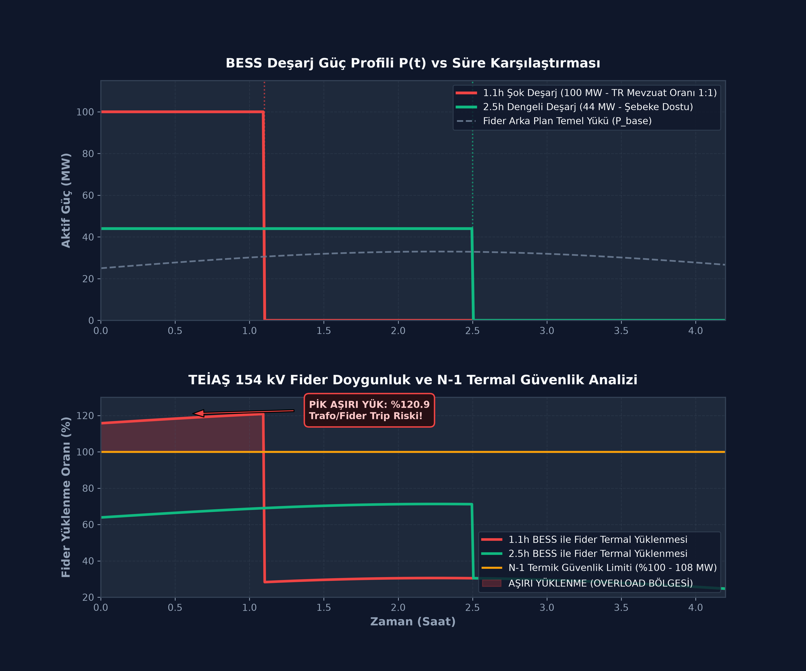
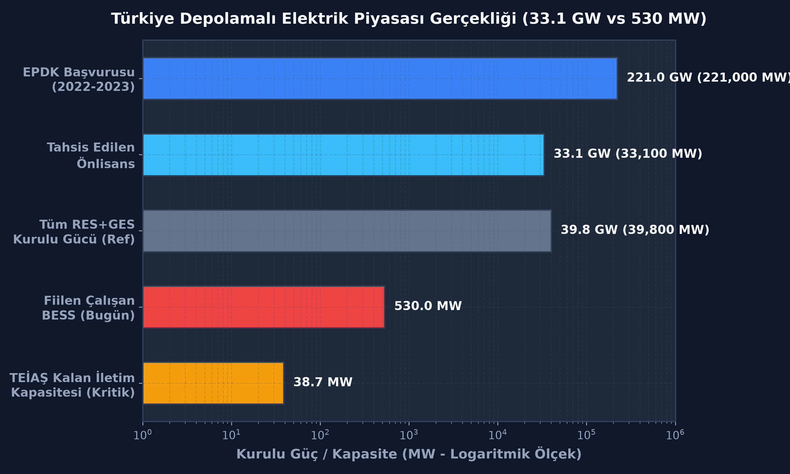

# Türkiye 33.1 GW Depolamalı RES/GES Kapasite & Şebeke İletim Analizi
## Turkey 33.1 GW BESS Pipeline & Grid Congestion Simulator

[](https://www.python.org/downloads/)
[](https://opensource.org/licenses/MIT)
[](#)

Türkiye elektrik iletim şebekesinde (TEİAŞ) **33.100 MW (33.1 GW)** depolamalı elektrik üretim önlisansının yarattığı trafo doygunluğu, fider termal yüklenme limitleri ve 1.1 saatlik şok deşarj batarya mimarisinin şebeke üzerindeki darbe etkisini simüle eden açık kaynaklı mühendislik modeli.

---

## 📊 1. Şebeke Doygunluk ve Fider Termal Yüklenme Analizi

Aşağıdaki simülasyon çıktısında; Türkiye'de yatırımcıların şebeke bağlantı hakkı kapabilmek için seçtiği **1.1 saatlik minimum mevzuat mimarisi (100 MW / 110 MWh)** ile şebeke dostu **2.5 saatlik dengeli deşarj (44 MW / 110 MWh)** arasındaki termal yüklenme farkı modellenmiştir:



### Kritik Mühendislik Bulguları:
1. **1.1 Saatlik Şok Deşarj Krizi:** 100 MW'lık gücün akşam puant saatinde 1.1 saat içinde fider üzerine boşaltılması, fiderin N-1 termik sınırını **%120.9 aşırı yüklenmeye (Overload)** sokmakta ve koruma rölelerini açma eşiğine getirmektedir.
2. **2.5 Saatlik Dengeleme:** Aynı 110 MWh'lık enerji 2.5 saate yayıldığında (44 MW), fider yüklenmesi **%71.3 seviyesinde kalarak** trafo ömrünü korumakta ve şebekeyi kilitlememektedir.

---

## 📉 2. Türkiye Depolama Piyasası Gerçekliği (Funnel)

EPDK'ya yapılan 221 GW'lık rekor başvurudan fiilen sahada dönen 530 MW'a kadar olan büyük huni (pipeline daralması):



* **221.000 MW (221 GW):** EPDK'ya yapılan toplam depolamalı santral başvurusu.
* **33.100 MW (33.1 GW):** Tahsis edilen toplam önlisans (Tüm Türkiye RES+GES kurulu gücünün %83'ü!).
* **530 MW:** Sahada fiilen devrede olan ve şebekeye bağlı batarya kapasitesi (~%1.6).
* **38.7 MW:** TEİAŞ güncel iletim kapasite haritasında ülke genelinde iletim seviyesinde kalan kullanılabilir kapasite!

---

## 🚧 3 Büyük Tıkanma Nedeni (Neden İlerleyemiyor?)

1. **Şebeke Tıkanması & Kısa Süreli Batarya Tasarımı:**
   Yatırımcılar MW başına minimum CAPEX ile maksimum kapasite tahsisi alabilmek için 1:1 güç-enerji oranını (1.1 saat) seçtiler. Ancak bu mimari puant saatte şebekeyi tıkamakta ve trafoları doygunluğa ulaştırmaktadır.
2. **2026 Süre Krizine Giriş (3 Yıllık Önlisans Kuralı):**
   6446 sayılı Kanun gereği 3 yıllık önlisans süresi içinde ÇED, imar, orman/mülkiyet izinlerini tamamlayıp üretim lisansı alamayan şirketlerin teminat mektupları irat kaydedilip önlisansları iptal edilecektir.
3. **Finansman & %30 Gümrük Vergisi Duvarı:**
   LFP hücre fiyatları küresel ölçekte $55/kWh seviyelerine inse de, yüksek faiz oranları, bankaların katı teminat mektubu komisyonları ve %30 ek gümrük vergisi santralleri finansal kapanışa götürmekte zorlamaktadır.

---

## 🚀 Hızlı Başlangıç (Quickstart)

```bash
# Repoyu klonlayın
git clone https://github.com/talhacrak01/bess-turkey-capacity.git
cd bess-turkey-capacity

# Bağımlılıkları yükleyin
pip install -r requirements.txt

# Simülasyonu çalıştırın ve grafikleri üretin
python simulate.py
```

---

## 👨‍💻 Yazar & İletişim

**Muhammed Talha Çırak**  
*Enerji Sistemleri Mühendisliği / Energy Systems Engineering*  
Adana Alparslan Türkeş Bilim ve Teknoloji Üniversitesi (ATÜ)  
* **Instagram:** [@talhacirak_energy](https://instagram.com/talhacirak_energy)  
* **GitHub:** [@talhacrak01](https://github.com/talhacrak01)  
* **LinkedIn:** [Muhammed Talha Çırak](https://linkedin.com/in/talha-cirak)

---

## 📄 Lisans
Bu proje [MIT Lisansı](LICENSE) kapsamında açık kaynaklıdır. Akademik çalışmalarda ve sektörel analizlerde kaynak gösterilerek serbestçe kullanılabilir.
